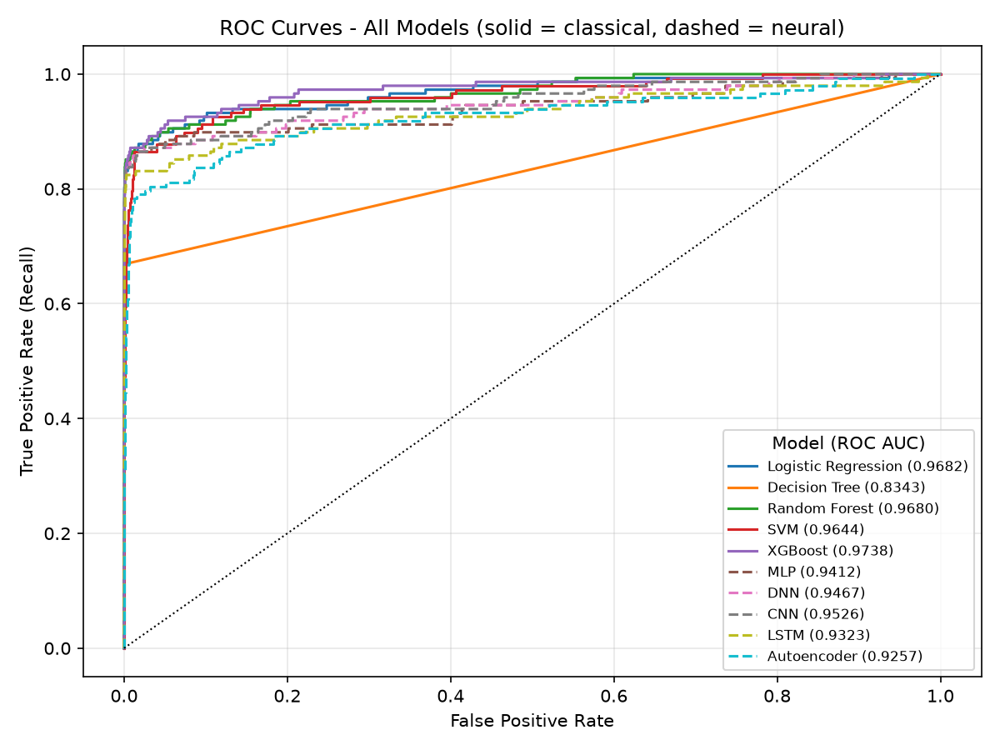

# Credit Card Fraud Detection 🔍💳

A comparison of **five classical machine learning models** and **five neural networks** for detecting fraudulent credit card transactions. All ten models are trained on the real, highly imbalanced data (no oversampling or undersampling) and evaluated on the **same held-out test set**.

📄 Full write-up: [`Final_Project_Report.pdf`](Final_Project_Report.pdf)

---

## 🏆 Results

Test set: 85,443 transactions, 148 of them fraud. Precision, recall and F1 are for the fraud class at a 0.5 decision threshold.

| Model | Family | Precision | Recall | F1 | ROC AUC | PR AUC | False alarms | Missed frauds | Train time (s) |
|---|---|---|---|---|---|---|---|---|---|
| Logistic Regression | Classical | 0.0671 | 0.8784 | 0.1248 | 0.9682 | 0.7050 | 1,806 | 18 | 0.7 |
| Decision Tree | Classical | 0.7734 | 0.6689 | 0.7174 | 0.8343 | 0.5179 | 29 | 49 | 24.6 |
| Random Forest | Classical | 0.7108 | 0.7973 | 0.7516 | 0.9680 | 0.7975 | 48 | 30 | 5.4 |
| SVM | Classical | 0.3103 | 0.6689 | 0.4240 | 0.9644 | 0.4029 | 220 | 49 | 67.8 |
| XGBoost | Classical | 0.2329 | 0.8514 | 0.3657 | 0.9738 | 0.7391 | 415 | 22 | 2.3 |
| MLP | Neural | 0.0956 | 0.8581 | 0.1720 | 0.9412 | 0.6719 | 1,202 | 21 | 101.2 |
| DNN | Neural | 0.0492 | 0.8716 | 0.0931 | 0.9467 | 0.6887 | 2,494 | 19 | 55.9 |
| CNN | Neural | 0.0588 | 0.8649 | 0.1101 | 0.9526 | 0.6783 | 2,049 | 20 | 77.2 |
| LSTM | Neural | 0.0818 | 0.8311 | 0.1490 | 0.9323 | 0.5642 | 1,380 | 25 | 367.9 |
| Autoencoder | Neural | 0.0269 | 0.8041 | 0.0521 | 0.9257 | 0.2904 | 4,302 | 29 | 250.5 |



**Key findings**
- **XGBoost** ranks fraud best (ROC AUC 0.9738) and trains in about 2 seconds.
- **Random Forest** gives the best precision–recall balance (F1 0.7516, PR AUC 0.7975) with only 48 false alarms.
- The **neural networks** catch a similar share of fraud but raise far more false alarms, rank fraud less well, and take 20–160× longer to train than XGBoost.
- The **Autoencoder**, trained without any fraud labels, still catches 80.4% of fraud.

---

## 🚀 Models

| Classical machine learning | Neural networks (TensorFlow/Keras) |
|---|---|
| Logistic Regression (balanced class weights) | MLP (one hidden layer, 64 units) |
| Decision Tree (depth tuned by cross-validation) | DNN (128 → 64 → 32, dropout 0.2) |
| Random Forest (50 trees, depth 10) | 1D CNN (features as a 6 × 5 grid) |
| SVM (RBF kernel) | LSTM (features as 30 time steps) |
| XGBoost (100 trees, depth 3) | Autoencoder (unsupervised, 30 → 16 → 8 → 16 → 30) |

## ⚙️ Method

- **No resampling.** Class imbalance is handled with class weights (`class_weight='balanced'`, XGBoost `scale_pos_weight`).
- **One shared test set.** 30% of the data is held out (stratified, fixed seed) and used to evaluate every model.
- **Classical models** train on the other 70%. **Neural networks** split it into 40% train / 30% validation and use the validation set for early stopping.
- **No leakage.** Features are standardized with a scaler fitted on the training data only.
- **Autoencoder** trains only on legitimate transactions and flags a transaction when its reconstruction error is above the 95th percentile of the training errors.
- **Reproducible.** All random seeds are fixed and TensorFlow runs deterministically, so re-running gives identical results.

---

## 📂 Dataset

**Kaggle:** [Credit Card Fraud Detection](https://www.kaggle.com/datasets/mlg-ulb/creditcardfraud). 284,807 transactions by European cardholders over two days in September 2013, of which 492 (0.17%) are fraud. Features `V1`–`V28` are PCA-anonymized, plus `Time` and `Amount`.

> The dataset is not included in this repository (GitHub's 100 MB file limit). Download it and place it at `data/creditcard.csv`.

---

## ▶️ How to Run

```bash
pip install -r requirements.txt

# Run all ten models (about 15 minutes on a laptop CPU)
python run_all.py

# Or run a single model
python classical_models/xgboost_model.py

# Rebuild the results table and ROC comparison from saved results
python run_all.py --summary

# Rebuild the PDF report from results/metrics.csv (needs Tectonic: https://tectonic-typesetting.github.io)
python report/build_report.py
```

---

## 📁 Project Structure

```
credit-card-fraud-detection/
├── common.py                  # Shared data loading, splits, scaling, training, metrics, plots
├── run_all.py                 # Runs every model and builds the combined results
├── classical_models/          # Logistic Regression, Decision Tree, Random Forest, SVM, XGBoost
├── neural_networks/           # MLP, DNN, CNN, LSTM, Autoencoder
├── data/                      # Put creditcard.csv here (not tracked)
├── results/
│   ├── metrics.csv            # One row per model
│   └── metrics/               # Full metrics for each model (JSON)
├── images/
│   ├── roc_comparison.png     # All ROC curves on one chart
│   ├── roc_curves/            # ROC curve for each model
│   └── confusion_matrices/    # Confusion matrix for each model
├── report/
│   ├── report_template.tex    # IEEE-style LaTeX source (numbers filled in from results/metrics.csv)
│   ├── report.tex             # Generated LaTeX with the numbers filled in
│   └── build_report.py        # Builds Final_Project_Report.pdf
├── Final_Project_Report.pdf
├── requirements.txt
└── README.md
```

---

## 🛠️ Tech Stack

Python 3.13 · scikit-learn · XGBoost · TensorFlow/Keras · pandas · NumPy · Matplotlib

---

## 📜 License

MIT License © 2025 [Keith Rodrigues](https://github.com/Keith2205)
